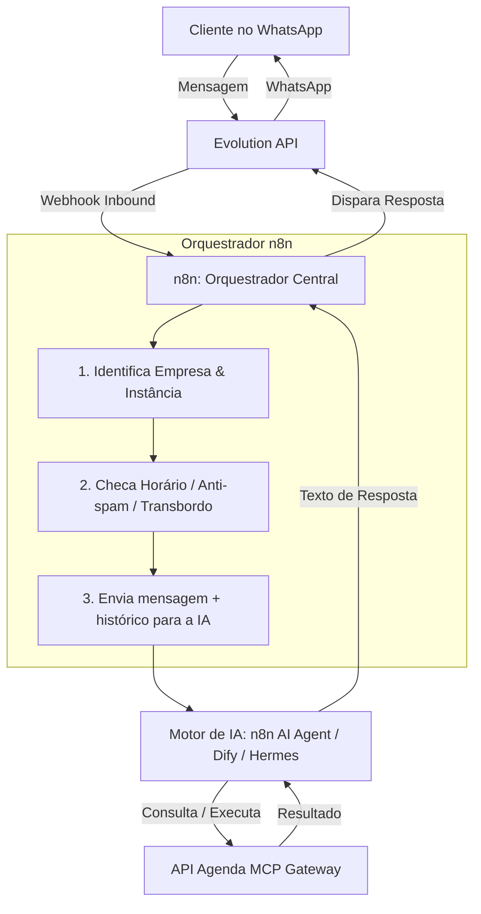

# Planejamento da Nova Arquitetura: Orquestração no n8n & Multi-Cliente

> **Registro de Conversa e Decisões de Arquitetura**  
> Data de registro: 14/10/2026  
> Projeto de Origem: `plataforma_atende_agenda`  
> Objetivo: Base para o novo projeto duplicado (evolução para multi-cliente e orquestração via n8n).

---

## 1. Contexto Atual do Sistema em Produção

* **Plataforma Atende Agenda:**
  * Backend em **FastAPI**, **SQLAlchemy 2.0** e **PostgreSQL 16**.
  * Painel Administrativo Web em [app/admin](file:///e:/Projetos/plataforma_atende_agenda/app/admin) (Tailwind + Jinja2).
  * Gestão de agendamentos, catálogo de serviços, profissionais e pagamentos PIX/Boleto/Cartão via **Asaas**.
  * **MCP (Model Context Protocol):** Endpoints `/mcp` e gateway expondo ferramentas prontas para agentes de IA.
* **Operação Atual (Single-Tenant):**
  * O sistema está em produção atendendo **um único cliente/estabelecimento**.
  * O **Hermes** está conectado diretamente ao WhatsApp, atuando como interface conversacional e orquestrador direto.
  * O **n8n** atua em segundo plano com subagentes (reconciliação financeira, cancelamentos, notificações de pagamento e lembretes).

---

## 2. Decisão: Criação de um Novo Projeto Isolado

Para evoluir o sistema sem colocar em risco a operação em produção do cliente atual:
1. **Duplicação da pasta:** O projeto será copiado para um novo diretório (ex.: `plataforma_atende_agenda_v2` ou novo nome do SaaS).
2. **Repositório Git independente:** Início de um novo histórico Git (`git init`), desvinculado do repositório anterior.
3. **Preservação:** O cliente atual permanece rodando intacto no ambiente original.

### Checklist de Limpeza ao Duplicar a Pasta:
Antes de inicializar o Git no novo projeto, remover da pasta duplicada:
- [x] Pasta `.git/` antiga (para criar um repositório limpo).
- [x] Arquivo `.env` com senhas e chaves reais de produção do cliente atual (manter apenas os arquivos `.env.example`).
- [x] Caches locais: `.pytest_cache/`, `.ruff_cache/`, `.mypy_cache/`, `node_modules/`, `__pycache__/`, `.worktrees/`.
- [x] Arquivos de banco locais temporários: `agenda.db`, `test_agenda.db` e backups `.sql`.

---

## 3. A Nova Arquitetura Proposta

### 3.1. Mudança de Papéis
| Componente | Papel Atual | Novo Papel no Novo Projeto |
| :--- | :--- | :--- |
| **WhatsApp (Evolution API)** | Conectado ao Hermes | Dispara webhooks de mensagens diretamente para o **n8n** |
| **n8n** | Subagentes de background | **Orquestrador Central & Roteador WhatsApp** (gerencia regras de negócio, horários, transbordo humano e direcionamento multi-cliente) |
| **Camada de Inteligência (IA)** | Hermes (WhatsApp + Raciocínio) | **Apenas Inteligência / Cérebro**: recebe o contexto do n8n, raciocina, executa ferramentas MCP e devolve a resposta |
| **API Agenda** | Backend transacional | Backend transacional com MCP Tools e suporte a multi-instância / multi-tenant |

---

### 3.2. Fluxo de Atendimento no Novo Modelo

---

## 4. Opções Avaliadas para a Camada de Inteligência

### Opção A: Nó nativo "AI Agent" do n8n *(Mais Recomendada para simplificar a stack)*
* **Como funciona:** O próprio n8n possui o nó `AI Agent` (baseado em LangChain) com nó de modelo (OpenRouter, OpenAI ou Groq), nó de memória de conversa (`PostgreSQL/Redis Chat Memory` por telefone/sessão) e nós de ferramentas (`Custom Tool` chamando os endpoints `/mcp`).
* **Vantagens:** 
  * Elimina completamente a necessidade de containers extras do Hermes.
  * O prompt e as credenciais da empresa podem ser passados dinamicamente com base na instância da Evolution API.
  * Todo o fluxo visual fica em uma única plataforma (n8n).

### Opção B: Dify.ai *(Melhor se desejar painel visual de IA)*
* **Como funciona:** Stack Docker do Dify rodando na VPS. O n8n recebe a mensagem do WhatsApp e repassa para a API do Dify (`/v1/chat-messages`).
* **Vantagens:** Workspaces nativos para cada cliente, histórico rico de conversas, métricas de tokens e painel onde o dono da empresa pode personalizar o tom da IA sem tocar em código.

### Opção C: Hermes Multi-Container
* **Como funciona:** Manter o Hermes atual, mas rodando 1 container leve (~60-100MB RAM) para cada cliente, isolando o `config.yaml` e os perfis.
* **Vantagens:** Reutiliza o perfil já testado do Hermes; porém exige gerenciar múltiplos containers e arquivos YAML.

---

## 5. Roteiro de Continuidade (Assim que a pasta for duplicada)

Quando a pasta duplicada for aberta no editor, o plano de execução será:
1. **Etapa 1:** Validação da limpeza da pasta duplicada e inicialização do repositório Git novo.
2. **Etapa 2:** Configuração da Evolution API para apontar o webhook diretamente para o n8n.
3. **Etapa 3:** Construção do Workflow Principal no n8n:
   * Nó de recepção da mensagem da Evolution API.
   * Definição da Inteligência (implementação do nó `AI Agent` do n8n com as ferramentas MCP da API).
   * Nó de envio de resposta de volta ao WhatsApp.
4. **Etapa 4:** Teste fim a fim de conversação, consulta de serviços, agendamento e pagamento.
5. **Etapa 5:** Estruturação da lógica multi-cliente (roteamento dinâmico por instância).
